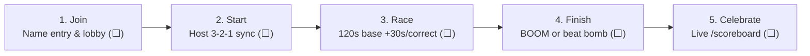

# Business Requirements Document (BRD): Answer It! or BOOM!

**Project:** Answer It! or BOOM! — Real-time cadet onboarding icebreaker quiz game
**Date:** 2026-11-17
**Version:** 1.0
**Owner:** Project Owner / Engineering
**Status:** Active
**Source of truth:** [`foundation.md`](foundation.md)
**Related:** [BPD](bpd.md) · [PRD](prd.md) · [SAD](sad.md) · [SDD](sdd.md) · [DSD](dsd.md) · [Flow](flow.md) · [Build](build.md) · [Evidence](evidence.md) · [Glossary](glossary.md)

---

> **Source-of-truth rule.** [`foundation.md`](foundation.md) is canonical. Resolve conflicts there first, then propagate.
>
> **Status legend:** defined in [`grounding.md`](grounding.md) §3 (`✅ 🟡 ⬜ ❓ ❌`). Never mark unbuilt capabilities `✅`.

---

## 1. Executive Summary

### 1.1 What Answer It! or BOOM! is

**Answer It! or BOOM!** is an internal, real-time web icebreaker quiz game for onboarding cohorts of software developer cadets (`S-01`).

### 1.2 Value proposition

> Get cadets laughing, relaxed, and talking in their first session while gently introducing basic software development vocabulary under zero grading pressure.

### 1.3 What the build delivers today

Phase 1 baseline Next.js App Router scaffold: Cartoon Bomb visual tokens, `Fredoka` + `Nunito` typography (zero monospace), `GAME_CONFIG` constants, and starter `/` shell. Gameplay, Realtime, database, and admin features remain planned (`⬜`).

### 1.4 Operating boundary

| Boundary | Detail |
|---|---|
| Environment | Local scaffold only (`⬜` not deployed to Vercel or Supabase yet) |
| Commercial status | Non-commercial internal onboarding tool (`bpd.md` is `N/A`) |
| Cohort usage | `⬜` Not yet piloted with a cadet cohort |

Explicit non-goals: [`prd.md`](prd.md) §6.

---

## 2. Business Problem

| Problem | Business / onboarding impact |
|---|---|
| First-session stiffness among new cadets | Cadets hesitate to speak up or socialize early in onboarding |
| Coding tests or typed quizzes intimidate beginners | Spelling errors or hard tasks create stress instead of camaraderie |
| Static or client-side quizzes lack urgency and fairness | Players finish independently, desync, or inspect answers in DevTools |

---

## 3. Business Solution — The Actual Lifecycle

---

## 4. System Roles

Canonical role identifiers live in [`glossary.md`](glossary.md) §2.

### 4.1 Player (Cadet) — `player` (⬜; `/` shell ✅)

- **Represents:** Onboarding software dev cadets on phones or laptops
- **Surfaces:** `/`, `/lobby`, `/play`, `/result`, `/scoreboard`
- **Responsibilities:** Enter unique name, wait in lobby, answer questions before server `deadline` expires, view rank
- **Security:** Cannot see `correct_index`; cannot replay once finished

### 4.2 Admin (Facilitator) — `admin` (⬜)

- **Represents:** Single session host / project owner
- **Surfaces:** `/admin`, `/admin/dashboard`, `/admin/questions`, `/scoreboard`
- **Responsibilities:** Create/reset session, kick disruptive names, lock lobby, start/end game, manage question pool
- **Security:** Protected by server-verified `ADMIN_PASSCODE` / middleware (`security.md` §5)

---

## 5. Stakeholders

Internal stakeholders only: **Cadets** (participants) and **Facilitator / Project Owner** (host). No external customers or partners exist.

---

## 6. Business Requirements with Status

### BR-01 Frictionless Cadet Join & Synchronized Lobby ⬜

Cadets join by name (`2–20` chars, trimmed, profanity-filtered) without accounts and see live lobby presence until host triggers synchronized countdown. **Traces:** `US-01` · `BOOM-02` · tests `T-002` (planned).

### BR-02 Server-Authoritative Fuse & Scoring Engine ⬜

Base `120s` timer, `+30s` and `+10 pts` per correct answer, milestone streak bonuses (`3→+5`, `5→+10`, `10→+20`), server `deadline` validation, and zero client exposure of `correct_index`. **Traces:** `US-02` · `BOOM-03` · tests `T-001` (planned).

### BR-03 One-Play-Only Enforcement ⬜

Each player may play once per session (`exploded` / `completed` blocks replay; duplicate session names rejected). **Traces:** `US-04` · `BOOM-04` · tests `T-003` (planned).

### BR-04 Live Projector Scoreboard ⬜

`/scoreboard` updates in real time sorted by `score DESC`, `correct_count DESC`, `survival_time DESC` with room-legible typography. **Traces:** `US-05` · `BOOM-05` · tests `T-004` (planned).

### BR-05 Facilitator Session & Question Management ⬜

Admin logs in via passcode, starts/ends/resets sessions, locks lobby, kicks players, and maintains a `50–100+` easy question pool (`~70%` dev / `~20%` general / `~10%` fun). **Traces:** `US-06..07` · `BOOM-06..07` · tests `T-005` (planned).

### BR-06 Cartoon-Bomb UI & Configurable Rules 🟡

Tunable rules in `src/config/game-config.ts` (`✅`) and cartoon-bomb tokens/fonts in `src/app/globals.css` (`✅`); interactive game animations, SVG bomb fuse, and Web Audio toggle remain `⬜`. **Traces:** `US-03`, `US-08` · `BOOM-01`, `BOOM-08`.

### Out of scope ❌

Player accounts, multi-room codes, PvP chat/sabotage, typed answers, AI questions, replay, native mobile app, offline play.

---

## 7. Technology Stack

Canonical: [`sad.md`](sad.md) §2; resolved lockfile pins: [`evidence.md`](evidence.md) §5.

---

## 8. Business Model

`N/A — internal onboarding game (non-commercial)` ([`bpd.md`](bpd.md)).

---

## 9. Competitive Position

`N/A — internal onboarding tool` ([`foundation.md`](foundation.md) §11).

---

## 10. Compliance and Risk

### 10.1 Compliance posture — intent, not attestation

| Area | Intent | Reality |
|---|---|---|
| Minimal data collection | Store display name + game scores only; no passwords or emails | Schema planned (`⬜`); no personal accounts |
| Security review | Server-side answer validation + RLS | `⬜` Outstanding (`security.md` §9) |

### 10.2 Risk register

| Risk | Impact | Owner | Mitigation status |
|---|---|---|---|
| Players clear localStorage/cookies to replay under a new name | Medium | Admin | ⬜ Admin **Lock Lobby** control after game start |
| Client-server clock skew distorts timer display | High | Engineering | ⬜ Server `deadline` + client clock offset sync (`ADR-0001`) |
| Profanity or inappropriate names appear on projector `/scoreboard` | Medium | Engineering / Admin | ⬜ Basic name filter + Admin **Kick Player** button |
| Question pool exhausted by fast players | Low | Project Owner | ⬜ Seed `60+` questions + `"You beat the bomb!"` finish state |

---

## 11. Success Metrics

| Candidate metric | Baseline | Target |
|---|---|---|
| Simultaneous cohort start without desync | Not measured | All joined players enter `/play` on countdown end (`S-01` §12) |
| Scoreboard room legibility | Not measured | Readable from across room on `/scoreboard` |
| Cadet engagement (qualitative observation) | Not measured | Cadets laugh, chat, and compare scores (`S-01` §12) |

---

## 12. Goal Alignment

Canonical text: [`foundation.md`](foundation.md) §12.

---

## 13. Open Business Decisions

See [`foundation.md`](foundation.md) §14 (`Q1–Q4`).

---

## Self-Check

- [x] Requirements carry honest status (`✅` only for verified baseline, `⬜` for unbuilt)
- [x] Non-commercial internal boundary stated
- [x] Risks include owners and realistic mitigations
