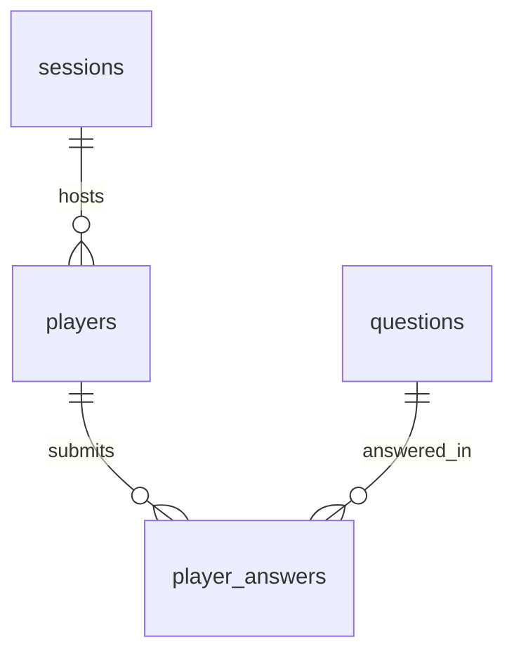

# Data Model: Answer It! or BOOM!

**Project:** Answer It! or BOOM! — Real-time cadet onboarding icebreaker quiz game
**Date:** 2026-11-17
**Version:** 1.0
**Owner:** Project Owner / Engineering
**Status:** Active (Schema migration & 60-question seed applied & verified on remote Supabase `zamxjnsxmtsreknsqrwj` `✅`)
**Source of truth:** [`foundation.md`](foundation.md)
**Related:** [SDD](sdd.md) · [Glossary](glossary.md) · [Security](security.md) · [API](api.md) · [Build](build.md) · [Grounding](grounding.md)

---

> **As-built rule.** [`supabase/migrations/20261117000001_init_schema.sql`](../supabase/migrations/20261117000001_init_schema.sql) and [`supabase/seed.sql`](../supabase/seed.sql) are applied and verified against remote `zamxjnsxmtsreknsqrwj` (`2026-11-17`).

---

## 1. Conventions

| Topic | Rule |
|---|---|
| Naming | `snake_case` plural tables (`sessions`, `players`, `questions`, `player_answers`) |
| Primary keys | `uuid` (`gen_random_uuid()`) |
| Timestamps | `timestamptz` (UTC) |
| Deletion | Session reset deletes/truncates cohort `players` (cascades `player_answers`); `questions` stay persistent |
| Tenancy | Single active session in MVP (`S-01` §6) |
| Numeric values | `integer` for seconds, scores, counts, and option indexes |

## 2. Entity Overview

4 planned tables:

## 3. Entity Catalog (✅ Applied to Remote `zamxjnsxmtsreknsqrwj`)

### `sessions`
| Field | Type | Null | Default | Constraint | PII | Description |
|---|---|---:|---|---|---:|---|
| `id` | `uuid` | No | `gen_random_uuid()` | PK | No | Session identifier |
| `status` | `text` | No | `'waiting'` | `CHECK (status IN ('waiting','countdown','running','finished'))` | No | Lifecycle state |
| `base_time_seconds` | `int` | No | `120` | `> 0` | No | Starting bomb fuse |
| `bonus_time_seconds` | `int` | No | `30` | `>= 0` | No | Added fuse on right answer |
| `points_per_correct` | `int` | No | `10` | `>= 0` | No | Base points per right answer |
| `wrong_answer_penalty_seconds` | `int` | No | `0` | `>= 0` | No | Optional penalty |
| `lobby_locked` | `boolean` | No | `false` | — | No | Stops new joins |
| `started_at` | `timestamptz` | Yes | `null` | — | No | Synchronized start timestamp |
| `created_at` | `timestamptz` | No | `now()` | — | No | Creation time |

### `players`
| Field | Type | Null | Default | Constraint | PII | Description |
|---|---|---:|---|---|---:|---|
| `id` | `uuid` | No | `gen_random_uuid()` | PK | No | Player identifier |
| `session_id` | `uuid` | No | — | FK → `sessions(id) ON DELETE CASCADE` | No | Parent session |
| `name` | `text` | No | — | `char_length(trim(name)) BETWEEN 2 AND 20`, unique per session (`lower(trim(name))`) | Low (display name) | Cadet name |
| `score` | `int` | No | `0` | `>= 0` | No | Current/final score |
| `correct_count` | `int` | No | `0` | `>= 0` | No | Correct answer count |
| `wrong_count` | `int` | No | `0` | `>= 0` | No | Wrong answer count |
| `streak` | `int` | No | `0` | `>= 0` | No | Current streak |
| `best_streak` | `int` | No | `0` | `>= 0` | No | Highest streak reached |
| `deadline` | `timestamptz` | Yes | `null` | — | No | Server bomb expiry time |
| `status` | `text` | No | `'waiting'` | `CHECK (status IN ('waiting','playing','exploded','completed'))` | No | Player state |
| `finished_at` | `timestamptz` | Yes | `null` | — | No | Completion / explosion timestamp |
| `joined_at` | `timestamptz` | No | `now()` | — | No | Join timestamp |

### `questions`
| Field | Type | Null | Default | Constraint | PII | Description |
|---|---|---:|---|---|---:|---|
| `id` | `uuid` | No | `gen_random_uuid()` | PK | No | Question identifier |
| `question` | `text` | No | — | non-empty | No | Prompt text |
| `options` | `jsonb` | No | — | array of 2–4 strings | No | Answer choices |
| `correct_index` | `int` | No | — | `0 <= correct_index < jsonb_array_length(options)` | No | Server-only answer index |
| `category` | `text` | No | — | `CHECK (category IN ('software','general','fun'))` | No | Category |
| `difficulty` | `text` | No | `'easy'` | `CHECK (difficulty IN ('easy','medium'))` | No | Difficulty (`easy` for MVP) |
| `is_active` | `boolean` | No | `true` | — | No | Enabled flag |

### `player_answers`
| Field | Type | Null | Default | Constraint | PII | Description |
|---|---|---:|---|---|---:|---|
| `id` | `uuid` | No | `gen_random_uuid()` | PK | No | Answer record ID |
| `player_id` | `uuid` | No | — | FK → `players(id) ON DELETE CASCADE` | No | Player |
| `question_id` | `uuid` | No | — | FK → `questions(id) ON DELETE CASCADE` | No | Question (`UNIQUE (player_id, question_id)`) |
| `selected_index` | `int` | No | — | `>= 0` | No | Selected option index |
| `is_correct` | `boolean` | No | — | — | No | Server evaluation |
| `answered_at` | `timestamptz` | No | `now()` | — | No | Submission time |

## 4. States and Transitions

State names match [`glossary.md`](glossary.md) §3:
- `sessions`: `waiting` → `countdown` → `running` → `finished` (enforced by Server Actions).
- `players`: `waiting` → `playing` → `exploded` | `completed` (terminal states cannot return to `playing`).

## 5. Constraints, Invariants, and Query Guardrails

| ID | Invariant | Authoritative enforcement point | Test |
|---|---|---|---|
| INV-01 | Case-insensitive unique name per session | Unique index `(session_id, lower(trim(name)))` + server validation | `T-002` (⬜) |
| INV-02 | One answer per `(player_id, question_id)` | `UNIQUE (player_id, question_id)` constraint | `T-004` (⬜) |
| INV-03 | `correct_index` never readable by `anon` | RLS `SELECT` denied on `questions` + column stripped in API | `T-004` (⬜) |
| INV-04 | Expired runs reject answers | Server checks `now <= player.deadline` before scoring | `T-001` (⬜) |

**Required indexes (Phase 2 migration):**
- `players (session_id, lower(trim(name)))` unique index
- `players (session_id, score DESC, correct_count DESC, finished_at ASC)` leaderboard index
- `player_answers (player_id)` FK lookup index
- `questions (id) WHERE is_active = true AND difficulty = 'easy'` partial index

## 6. Access Control per Entity

| Entity | `anon` Read | `anon` Write | Server (`service_role`) | Mechanism |
|---|---|---|---|---|
| `sessions` | Allow (Realtime) | Deny | Allow | Supabase RLS |
| `players` | Allow (Realtime) | Deny | Allow | Supabase RLS |
| `questions` | **Deny** | Deny | Allow | Supabase RLS |
| `player_answers` | **Deny** | Deny | Allow | Supabase RLS |

## 7. Classification, Retention, and Deletion Verification

| Entity | PII | Retention | Derived stores | Disposal | Legal basis |
|---|---|---|---|---|---|
| `players` | Display name only | Session lifetime (cleared on Admin Reset) | None (`no analytics PII`) | Cascade delete on session reset | Internal onboarding |

## 8. Migrations and Backfills

Location: `supabase/migrations/` (`20261117000001_init_schema.sql` applied & verified `✅` on `zamxjnsxmtsreknsqrwj`, `2026-11-17`). Seed data: `supabase/seed.sql` (1 `waiting` session + 60 easy questions: 42 `software`, 12 `general`, 6 `fun`). CLI config: `supabase/config.toml`. Never edit merged migrations.

## 9. Derived Data

None (`scoreboard` queries `players` directly with composite index).

## 10. Open Data Decisions

- Confirm streak bonus repeatability (`foundation.md` §14 `Q2`) before Phase 3 engine tests.

---

## Self-Check

- [x] Migration and seed files applied and verified against remote Supabase (`2026-11-17`)
- [x] `correct_index` RLS denial and composite indexes verified (`401`/`42501` for `anon` on `questions`/`player_answers`)
- [x] States match `glossary.md` §3
