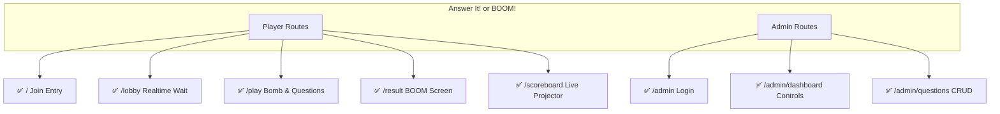

# Answer It! or BOOM! — App Flow and Feature Scope

**Project:** Answer It! or BOOM! — Real-time cadet onboarding icebreaker quiz game
**Date:** 2026-11-17
**Version:** 1.0
**Owner:** Project Owner / Engineering
**Status:** Active
**Source of truth:** [`foundation.md`](foundation.md)
**Related:** [BRD](brd.md) · [PRD](prd.md) · [SAD](sad.md) · [SDD](sdd.md) · [DSD](dsd.md) · [Build](build.md) · [Test plan](test-plan.md)

---

> **Purpose.** Honest status map of what is built (`✅`), partial (`🟡`), or planned (`⬜`). Marks match [`grounding.md`](grounding.md) §3.

**Operating boundary:** Phase 1–4 + `BOOM-05` (`/`, `/lobby`, `/play`, `/result`, `/scoreboard`, `/admin`, `/admin/dashboard`, `/admin/questions`) built & E2E-verified locally against remote Supabase `zamxjnsxmtsreknsqrwj` (`2026-11-17`). Not deployed to Vercel; `BOOM-06` sound/motion polish & deploy pending.

---

## 1. Surfaces — What Lives Where



## 2. Feature Scope Matrix

| Capability | Priority | Status | Where | Verified by |
|---|---|---|---|---|
| Next.js App Router + Tailwind v4 + `Fredoka`/`Nunito` (no mono) + `GAME_CONFIG` | Must | ✅ | `src/app/layout.tsx`, `globals.css`, `src/config/game-config.ts` | `npm run lint`, `tsc --noEmit`, `npm run build` |
| Starter `/` join card & live submit | Must | ✅ | `src/app/page.tsx`, `src/components/join-form.tsx` | `npm run build`, Playwright E2E (`2026-11-17`) |
| Supabase schema, indexes, RLS & 60+ question seed | Must | ✅ | `supabase/migrations/20261117000001_init_schema.sql`, `supabase/seed.sql` | Remote REST RLS & seed check (`2026-11-17`: `60` questions, `1` session, `anon` denied `42501` on `questions`/`player_answers` & writes) |
| Player join, duplicate/profanity guard & Realtime `/lobby` | Must | ✅ | `src/app/lobby/page.tsx`, `src/components/lobby-view.tsx` | `npm test` (`T-002`, `T-003`), Playwright E2E (`2026-11-17`) |
| Synchronized 3-2-1 countdown & server-deadline `/play` race | Must | ✅ | `src/app/play/page.tsx`, `src/components/play-view.tsx`, `src/components/bomb-timer.tsx` | `npm test` (`T-001`, `T-004`), Playwright E2E (`2026-11-17`) |
| One-play-only lock, `/result`, & `/scoreboard` | Must | ✅ | `src/app/result/page.tsx`, `src/app/scoreboard/page.tsx` | `npm test` (`T-003`), Playwright E2E `T-005` (`2026-11-17`) |
| Admin passcode auth, session controls, & question CRUD | Must | ✅ | `src/lib/admin-auth.ts`, `src/lib/admin-service.ts`, `src/app/admin/**`, `src/app/api/admin/**` | `npm test` (`T-006`), Playwright E2E (`2026-11-17`) |
| Sound toggle & Framer Motion polish | Should | ⬜ planned | `⬜` | — |

## 3. Verification Commands

```bash
npm run lint
npx tsc --noEmit
npm run build
node scripts/check-docs.mjs --mode=project
```

*Update this file in the same change that alters feature status.*
