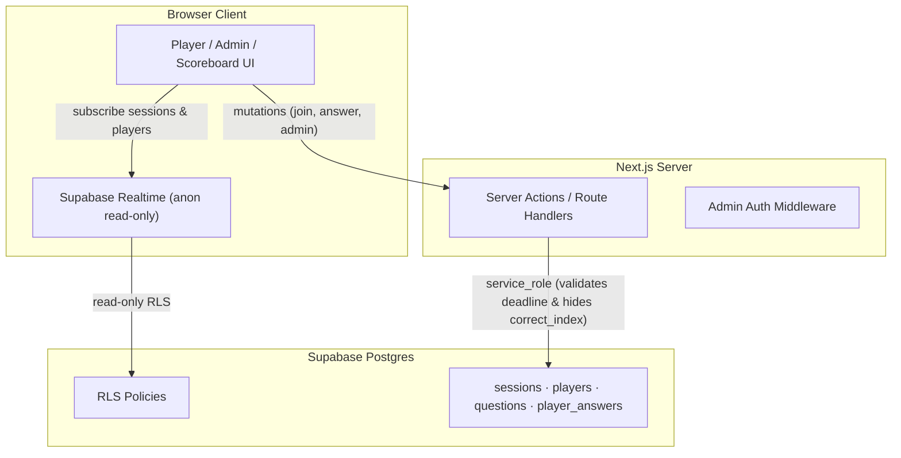

# Software Architecture Document (SAD): Answer It! or BOOM!

**Project:** Answer It! or BOOM! — Real-time cadet onboarding icebreaker quiz game
**Date:** 2026-11-17
**Version:** 1.0
**Owner:** Project Owner / Engineering
**Status:** Active
**Source of truth:** [`foundation.md`](foundation.md)
**Related:** [BRD](brd.md) · [PRD](prd.md) · [SDD](sdd.md) · [DSD](dsd.md) · [Flow](flow.md) · [Build](build.md) · [Security](security.md) · [Ops](ops.md) · [Grounding](grounding.md) · [Evidence](evidence.md) · [Glossary](glossary.md)

---

> **Source-of-truth rule.** [`foundation.md`](foundation.md) is canonical.
>
> **Architecture truth.** Phase 1 Next.js frontend scaffold is built (`✅`); Supabase schema, Server Actions, Realtime subscriptions, and Vercel deployment are target architecture (`⬜`).

---

## 1. Architectural Pattern & Topology

Full-stack **Next.js App Router** monolith backed by **Supabase** (Postgres + Realtime) and hosted on **Vercel**:

- **Thin UI + Server-Authoritative State:** Browsers read public session/player state via Supabase Realtime (`anon` read-only RLS) and submit all mutations to Next.js Server Actions / Route Handlers running with `SUPABASE_SERVICE_ROLE_KEY`.
- **Clock Integrity:** Never trust client clocks. The server stores `started_at` and per-player `deadline` (`ADR-0001`).

### 1.3 Repository Layout

| Layer | Path | Status |
|---|---|---|
| App Router pages & layouts | `src/app/` | 🟡 (`layout.tsx`, `globals.css`, `page.tsx` ✅; other routes `⬜`) |
| Game config | `src/config/game-config.ts` | ✅ |
| Domain engine & Supabase clients | `src/lib/` | ⬜ |
| UI components | `src/components/` | ⬜ |
| Shared types | `src/types/` | ⬜ |
| DB migrations & seed | `supabase/` | ⬜ |

---

## 2. Technology Stack

Resolved lockfile pins live in [`evidence.md`](evidence.md) §5.

| Layer | Technology | Declared range / status | Resolved pin | Rationale / trade-off |
|---|---|---|---|---|
| Framework | Next.js (App Router) | `16.4.6` ✅ | [`evidence.md`](evidence.md) §5 | SSR/Server Actions + `next/font/google` + single deploy unit on Vercel |
| UI Runtime | React / React DOM | `19.3.0` ✅ | [`evidence.md`](evidence.md) §5 | Standard Next.js runtime |
| Language | TypeScript | `^5` ✅ | [`evidence.md`](evidence.md) §5 | Strict contract safety across server/client |
| Styling & Fonts | Tailwind CSS v4 + `Fredoka`/`Nunito` | `4.3.3` ✅ | [`evidence.md`](evidence.md) §5 | Fast utility styling with CSS tokens; zero monospace fonts (`dsd.md` §2.4) |
| Database & Realtime | Supabase (`@supabase/supabase-js`) | `⬜ Not installed` | `—` | Combined Postgres, RLS, and Realtime WebSockets without custom WS infra |
| Admin Auth | `ADMIN_PASSCODE` signed `httpOnly` cookie | `⬜ Proposed` (`ADR-0002`) | `—` | Zero user-management overhead for single facilitator vs full Supabase Auth |
| Animation | Framer Motion (`framer-motion`) | `⬜ Not installed` | `—` | *Persuade/Experience*-style game feedback (`BOOM`, `+30s` pop, fuse) with `prefers-reduced-motion` |
| Hosting | Vercel | `⬜ Not deployed` | `—` | Native Next.js hosting and server-only env vars |
| Tests | Vitest | `⬜ Not installed` | `—` | Fast unit/contract testing for pure game rules and service boundaries |

---

## 3. Component Communication

---

## 4. Quality Attributes

### 4.1 Service-level objectives

**No measured SLO exists.** Targets remain `TBD` until a cohort session is measured in a live environment.

### 4.2 Correctness and integrity

- **Server-authoritative timer:** `deadline = started_at + base_time + (correct_count * bonus_time)` checked server-side (`now <= deadline`).
- **Answer secrecy:** `questions.correct_index` never leaves the server.
- **Idempotent answer recording:** `UNIQUE (player_id, question_id)` prevents duplicate submissions from double-awarding points/time.
- **One-play-only lock:** Terminal player states (`exploded`, `completed`) reject new answers.

### 4.3 Security

Canonical: [`security.md`](security.md). Key controls: RLS on all 4 tables, `anon` blocked from `questions` and `player_answers`, `SUPABASE_SERVICE_ROLE_KEY` and `ADMIN_PASSCODE` server-only.

### 4.4 Scalability & Operability

Target use is single-cohort onboarding sessions (`~10–100` concurrent players, unmeasured). Operability details: [`ops.md`](ops.md).

---

## 5. Architectural Constraints and Debt

| Constraint | Why it exists | Consequence |
|---|---|---|
| Single active session at a time | MVP simplicity (`S-01` §6) | Adding room codes later requires multi-session routing/filtering |
| Storage/cookie identity can be cleared by determined player | Frictionless no-account join (`S-01` §8.4) | Admin **Lock Lobby** mitigates late replay attempts |

---

## 6. Architectural Decisions

Recorded in [`adr/README.md`](adr/README.md): `ADR-0001` (Server-authoritative deadlines), `ADR-0002` (Admin passcode cookie), `ADR-0003` (Service-role mutations + RLS read-only Realtime).

---

## Self-Check

- [x] Target vs. current implemented state distinguished honestly
- [x] Resolved lockfile versions referenced in `evidence.md` §5
- [x] SLOs kept `TBD` rather than invented
