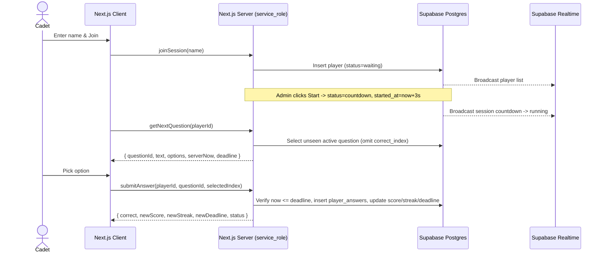

# System Design Document (SDD): Answer It! or BOOM!

**Project:** Answer It! or BOOM! — Real-time cadet onboarding icebreaker quiz game
**Date:** 2026-11-17
**Version:** 1.0
**Owner:** Project Owner / Engineering
**Status:** Active
**Source of truth:** [`foundation.md`](foundation.md)
**Related:** [BRD](brd.md) · [PRD](prd.md) · [SAD](sad.md) · [DSD](dsd.md) · [Flow](flow.md) · [Build](build.md) · [API](api.md) · [Data model](data-model.md) · [Security](security.md)

---

> **As-built vs. target rule.** Mark every subsystem with its actual status (`✅ 🟡 ⬜ ❓`, [`grounding.md`](grounding.md) §3). **Trust observed code over this document.**

---

## 1. Components and Subsystems

### 1.1 Client subsystems

| Subsystem | Location | Responsibility | Status |
|---|---|---|---|
| Root layout & theme tokens | `src/app/layout.tsx`, `src/app/globals.css` | `Fredoka`/`Nunito` fonts (no mono), Cartoon Bomb CSS vars | ✅ |
| Game rule constants | `src/config/game-config.ts` | Base timer (`120s`), bonus (`+30s`), points (`+10`), streaks | ✅ |
| Starter `/` join shell | `src/app/page.tsx` | Responsive join card shell (submit disabled until Phase 3) | 🟡 |
| Player lobby, race, result, scoreboard | `src/app/lobby`, `play`, `result`, `scoreboard` | Realtime lobby, timer UI, BOOM screen, live projector ranking | ⬜ |
| Admin login, dashboard, questions | `src/app/admin/**` | Facilitator controls and question CRUD | ⬜ |

### 1.2 Backend services (Server Actions / Route Handlers)

| Service / function | Location | Responsibility | Auth | Status |
|---|---|---|---|---|
| Game rules & validator | `src/lib/game-rules.ts`, `validation.ts` | Pure scoring, streak, deadline, tie-breaker, name rules | Public / internal | ⬜ |
| Player join & question flow | `src/app/api/**` or Server Actions | Join session, fetch unseen question (no `correct_index`), submit answer | Player cookie / ID | ⬜ |
| Admin session & question ops | `src/app/api/admin/**` | Passcode login, start/end/reset, lock lobby, kick, question CRUD | Admin `httpOnly` cookie | ⬜ |

### 1.3 Data subsystem

4 planned Postgres tables in Supabase (`sessions`, `players`, `questions`, `player_answers`); migrations not yet created (`⬜`). Detail: [`data-model.md`](data-model.md).

---

## 2. Contracts

Endpoint index, request/response rules, and error catalog live in [`api.md`](api.md).

---

## 3. Data Flow

### 3.1 Synchronized Start & Answer Flow (⬜ Planned)

### 3.2 Background / Expiry Handling (⬜ Planned)
No background worker daemon is required for MVP:
- Client renders `deadline - (Date.now() + serverOffset)` locally and routes to `/result` at `0:00`.
- Server authoritatively rejects any late submission (`now > deadline`) and flips `players.status = 'exploded'` and `finished_at = now`.
- Admin **End Game Early** updates all active `players` rows to `exploded` and `sessions.status = 'finished'` in one transaction.

---

## 4. Data Layer

Entities, constraints, indexes, and retention: [`data-model.md`](data-model.md). RLS matrix: [`security.md`](security.md) §5.

---

## 5. Configuration and Environments

**Client variables** (`NEXT_PUBLIC_*`, names only): `NEXT_PUBLIC_SUPABASE_URL`, `NEXT_PUBLIC_SUPABASE_ANON_KEY`.
**Backend secrets** (names only; git-ignored `.env.local`): `SUPABASE_SERVICE_ROLE_KEY`, `ADMIN_PASSCODE`.
**Tunable game config:** `src/config/game-config.ts` (`✅`) + `sessions` table defaults (`⬜`).

---

## 6. Error Handling, Configuration Validation, and Observability

- **Startup/action env validation:** Server Supabase client must fail explicitly if `NEXT_PUBLIC_SUPABASE_URL` or `SUPABASE_SERVICE_ROLE_KEY` is missing.
- **Duplicate / expired handling:** Duplicate answer inserts (`23505` on `(player_id, question_id)`) return idempotent already-answered result without adding points; expired `deadline` marks player `exploded` cleanly.
- **Observability today:** Console output locally; structured `correlationId` logging planned (`⬜`).

---

## 7. Open Design Decisions

Tracked in [`foundation.md`](foundation.md) §14 (`Q1–Q4`) and [`adr/README.md`](adr/README.md).

---

## Self-Check

- [x] Built vs planned subsystems honestly marked
- [x] Config lists variable names only (no secret values)
- [x] Server clock sync & expiry behavior explicitly documented
